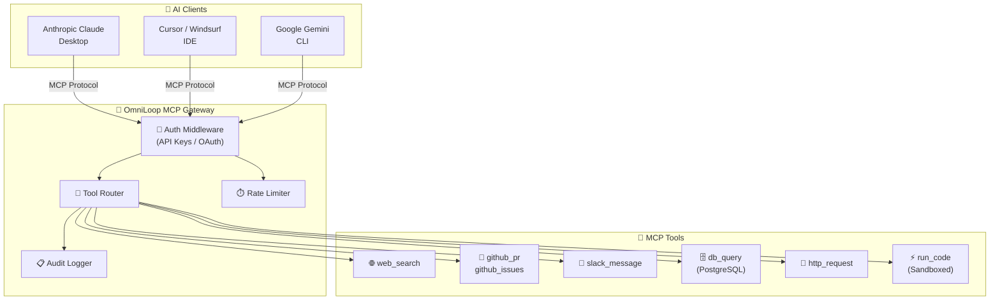

<div align="center">

# 🔄 OmniLoop-MCP

**Enterprise Model Context Protocol Federation Gateway**

[](https://github.com/harinish45/OmniLoop-MCP/actions/workflows/ci.yml)
[](LICENSE)
[](https://typescriptlang.org)
[](https://spec.modelcontextprotocol.io)

> *Enterprise MCP server connecting Claude, Gemini, and GPT to real-world tools — Slack, GitHub, databases, and more*

[📋 TODO](TODO.md) · [📄 PRD](PRD.md) · [⚙️ Config](config/)

</div>

---

## 🏗️ Architecture



---

## 🚀 Quick Start

```bash
git clone https://github.com/harinish45/OmniLoop-MCP.git
cd OmniLoop-MCP
npm install
npm run build
npm start
```

**Claude Desktop config** (`~/Library/Application Support/Claude/claude_desktop_config.json`):
```json
{
  "mcpServers": {
    "omniloop": {
      "command": "node",
      "args": ["/path/to/OmniLoop-MCP/dist/server.js"]
    }
  }
}
```

---

## 🔧 Tool Coverage

| Tool | Implemented | Tests | Priority |
|------|-------------|-------|----------|
| `web_search` | 🔧 | ❌ | HIGH |
| `read_file` | 🔧 | ❌ | HIGH |
| `http_request` | 🔧 | ❌ | HIGH |
| `github_pr` | ❌ | ❌ | MEDIUM |
| `slack_message` | ❌ | ❌ | MEDIUM |
| `db_query` | ❌ | ❌ | MEDIUM |
| `run_code` | ❌ | ❌ | HIGH |

---

## 📁 Structure

```
OmniLoop-MCP/
├── 🔧  src/
│   ├── tools/         # MCP tool implementations
│   ├── resources/     # Resource providers
│   ├── prompts/       # Prompt templates
│   └── server.ts      # Entry point
├── ⚙️  config/        # Server configuration
├── 🧪  tests/         # Vitest test suite
└── 📋  task.md        # Sprint tasks
```

---

<div align="center">
<a href="LICENSE">MIT License</a> · Built by harinish45
</div>