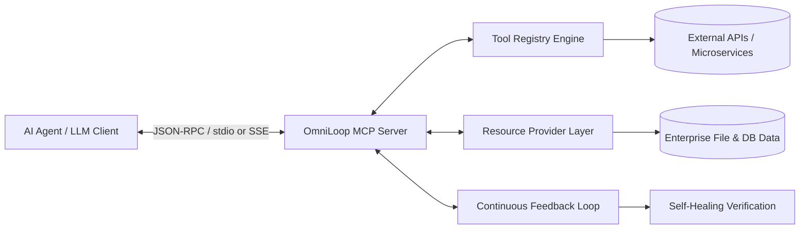

# 🔄 OmniLoop-MCP
> **High-performance Model Context Protocol (MCP) server suite connecting LLMs with enterprise systems, automated tool synthesis, and continuous agent loops.**

[](https://opensource.org/licenses/MIT)
[](https://www.typescriptlang.org/)
[](https://modelcontextprotocol.io/)
[]()

---

## 🏛️ System Architecture

OmniLoop-MCP acts as an enterprise bridge between Large Language Models (Claude, Antigravity, OpenAI, Gemini) and distributed infrastructure tools, databases, and continuous execution loops.



---

## 🚀 Core Features

* **Dual Transports:** High-speed `stdio` transport for local CLI/IDE integrations and Server-Sent Events (`SSE`) for distributed cloud agents.
* **Dynamic Tool Registry:** Zero-overhead tool definitions with JSON schema validation.
* **Continuous Feedback Loops:** Autonomous agent execution loops with verification checks.
* **Built-in Security Guardrails:** Rate limiting, argument sanitization, and permission scopes.

---

## 📦 Quick Start

```bash
npm install
npm run build
npm start
```

### Claude Desktop / Antigravity MCP Configuration
Add to your `mcp.json` or `claude_desktop_config.json`:
```json
{
  "mcpServers": {
    "omni-loop": {
      "command": "node",
      "args": ["path/to/OmniLoop-MCP/dist/index.js"],
      "env": {
        "NODE_ENV": "production"
      }
    }
  }
}
```

---

## 🤖 Vibe Coding & Autonomous AI Development
This repository is pre-configured for autonomous AI agents and vibe-coding tools:
* [`PRD.md`](./PRD.md) — Comprehensive product requirements and tool schemas.
* [`ROADMAP.md`](./ROADMAP.md) — Feature trajectory.
* [`TODO.md`](./TODO.md) — Atomic implementation checklist with unit test acceptance criteria.
* [`AGENTS.md`](./AGENTS.md) — Rules for autonomous AI development.

## 📄 License
MIT License - see [LICENSE](LICENSE) for details.
